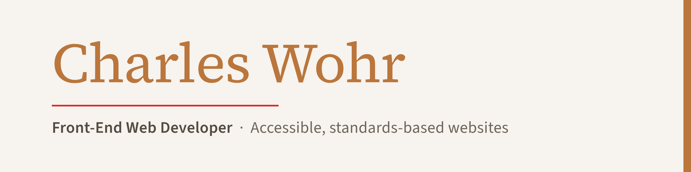
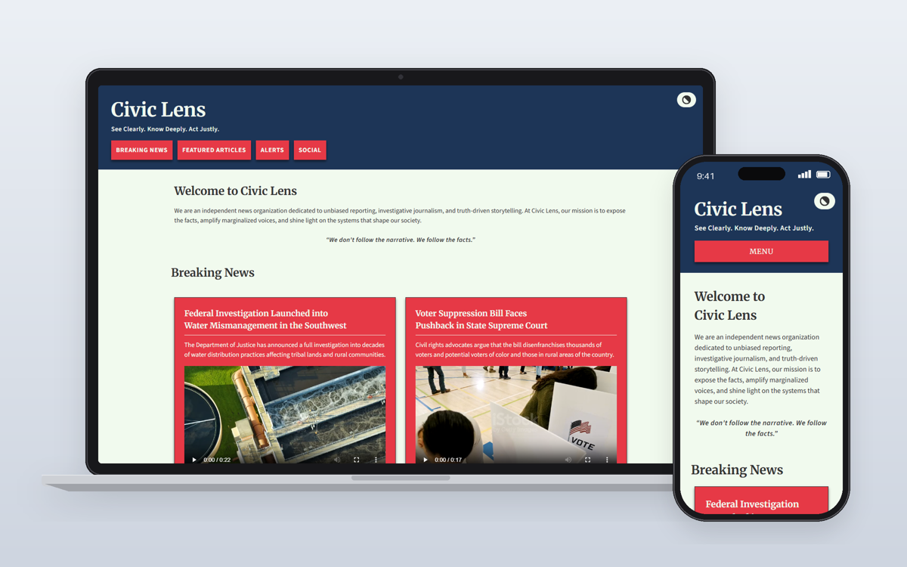
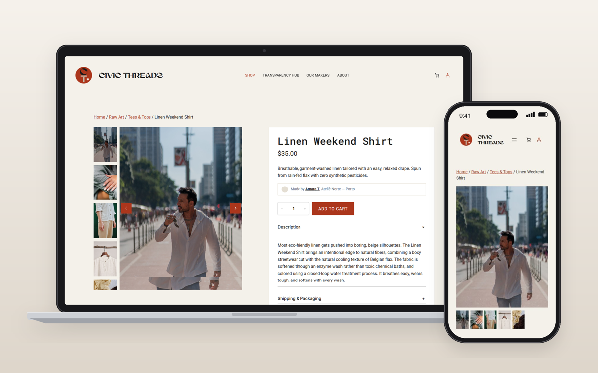
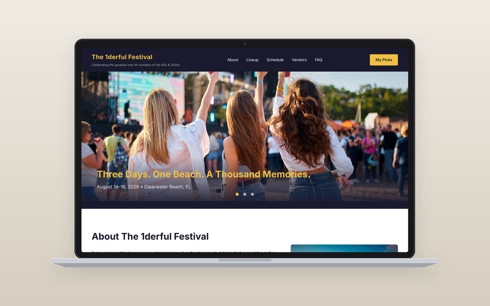

## Hi, I'm Charles 👋

I'm a front-end web developer finishing a B.S. in Graphic Information Technology (Full-Stack Web Development) at Arizona State University, graduating December 2026. Before code, I spent 15 years as a dog trainer and behaviorist, which taught me how to listen to clients, explain complex things simply, and build trust. Now I bring that same approach to building clear, accessible websites.

📍 Providence, RI · Open to remote work

### 🔨 Currently

- **Building:** BarkBooked, a booking and session manager for independent dog trainers (senior project)
- **Learning:** Back-end development with Python and Flask, SQLite databases, and Jinja2 templating
- **Also working on:** my portfolio website and a new Dogs by Charles website

### 🗂️ Featured Projects

| Project | What it is | Built with |
|---|---|---|
| [**Civic Lens**](https://cwohr.github.io/civic-lens) | Accessibility and web standards retrofit of an investigative news site | HTML, CSS, WCAG, W3C validation |
| [**Civic Threads Apparel**](https://civicthreads.store/) | Verified Impact component for a sustainable clothing store, built on a cross-functional team | WordPress, WooCommerce, HTML, CSS, JavaScript |
| [**The 1derful Festival**](https://www.behance.net/gallery/248435195/GIT418-Final-Project) | Interactive single-page festival site with a JSON-driven lineup and saved picks | JavaScript, jQuery, jQuery UI, AJAX, Web Storage |

  
  
  

### 🧰 Languages & Tools

HTML5 · CSS3 · JavaScript · jQuery · WordPress · WooCommerce · Python · Flask · SQLite · Git · GitHub · VS Code · Illustrator · Photoshop

### 🤝 How I Work

- **Accessibility first:** WCAG guidelines, semantic HTML, and code that validates
- **Clear communication:** I explain technical choices in plain language
- **Built to last:** content kept separate from code so sites are easy to update

### 📫 Contact

- **Portfolio:** coming December 2026
- **Behance:** [behance.net/charleswohr1](https://www.behance.net/charleswohr1)
- **Email:** [cawohr@gmail.com](mailto:cawohr@gmail.com)
